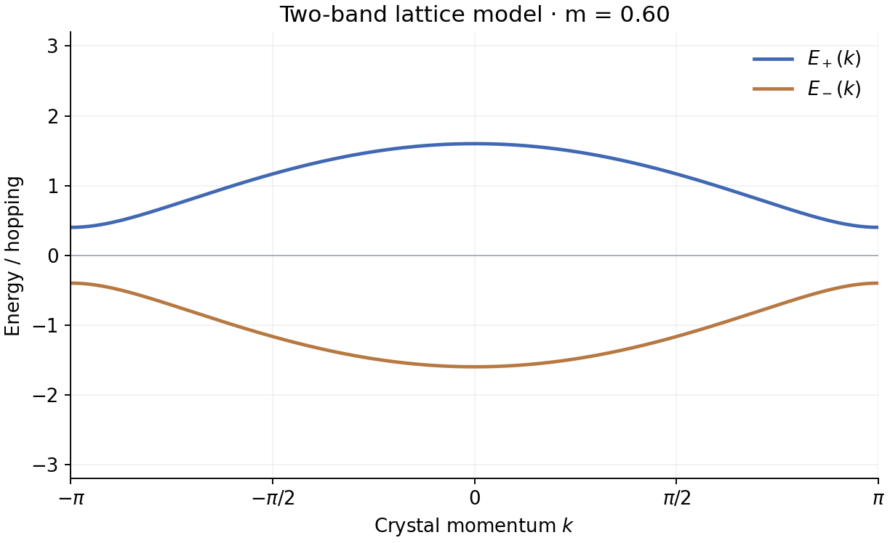

# Notebook：从计算记录到文章

Notebook 保留文字、公式、代码和实际计算输出。这个例子使用与独立脚本相同的两能带模型。

$$H(k,m)=\sin k\,\sigma_x+(m+\cos k)\,\sigma_z.$$


```python
import numpy as np
from scipy.linalg import eigvalsh
k, m = np.pi, 0.6
H = np.array([[m + np.cos(k), np.sin(k)],
              [np.sin(k), -(m + np.cos(k))]])
energies = eigvalsh(H)
print("Eigenvalues:", np.round(energies, 6))
print(f"Gap: {energies[1] - energies[0]:.2f}")
```

    Eigenvalues: [-0.4  0.4]
    Gap: 0.80


## 与解析式比较

区边界处 $E_\pm=\pm|m-1|$，因此本例应得到能隙 $0.8$。下面的断言是执行过程的一部分。


```python
expected = np.array([-abs(m - 1), abs(m - 1)])
assert np.allclose(energies, expected)
{"agreement": True, "gap": float(np.round(np.diff(energies)[0], 8))}
```


    {'agreement': True, 'gap': 0.8}


## 静态图输出

使用同一次生成任务得到的图像。下图来自 Notebook 的图片输出，不是远程 iframe。


```python
from IPython.display import Image, display
display(Image(filename="bands.png"))
```


    

    


